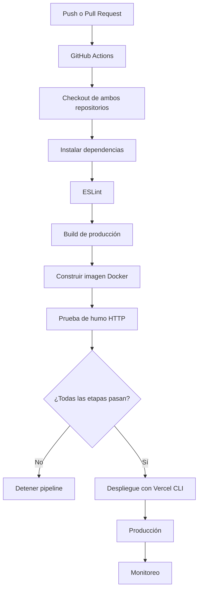

# Caso de estudio: integración, liberación y despliegue continuo de PDF Tool

**Proyecto:** PDF Tool  
**Repositorio de aplicación:** https://github.com/AngelR-26/pdf-tool  
**Repositorio de automatización:** https://github.com/AngelR-26/project-ci-cd  
**Rama de trabajo:** `devops/ci-cd`  
**Fecha:** noviembre de 2026

## 1. Descripción del caso

PDF Tool es una aplicación web construida con Next.js, React y TypeScript para trabajar con documentos PDF, incluyendo unir y separar archivos. Utiliza dependencias como `pdf-lib` y `jszip`.

El objetivo es establecer un proceso repetible para validar cada cambio, preparar un entorno de liberación equivalente y publicar una versión en producción mediante Vercel. El repositorio `project-ci-cd` conserva la automatización; el código permanece en `pdf-tool` y se obtiene durante el pipeline.

## 2. Justificación del flujo de trabajo

El pipeline propuesto consta de seis etapas:

1. **Control de versiones:** cambios en ramas y Pull Requests.
2. **Integración continua:** GitHub Actions descarga ambos repositorios, instala dependencias con pnpm fijado, ejecuta ESLint y compila la aplicación.
3. **Preparación:** Docker construye una imagen de PDF Tool con las dependencias y el build de producción.
4. **Verificación:** se inicia el contenedor y se realiza una petición HTTP a la página principal.
5. **Despliegue:** si todas las verificaciones pasan, GitHub Actions utiliza Vercel CLI para publicar en producción.
6. **Monitoreo:** revisar estado del despliegue, disponibilidad, latencia y errores en Vercel.

Esta separación reduce errores manuales, evita publicar versiones que no compilan y permite reproducir el entorno mediante Docker.

### Diagrama del pipeline

## 3. Entorno requerido

| Componente | Requisito |
|---|---|
| Sistema operativo local | Windows 10/11, Linux o macOS |
| Runtime | Node.js 22 LTS |
| Gestor de paquetes | pnpm 12.3.4 mediante Corepack |
| Control de versiones | Git |
| Contenedores | Docker Desktop o Docker Engine |
| Aplicación | Next.js 16, React 19 y TypeScript |
| CI | GitHub Actions con `ubuntu-latest` |
| Despliegue | Vercel |

El runner de CI instala dependencias con `pnpm install --frozen-lockfile`, ejecuta `pnpm lint` y `pnpm build`. Docker utiliza `node:22-alpine`, expone el puerto 3000 y ejecuta `pnpm start`.

## 4. Niveles de servicio acordados (objetivos propuestos)

Los siguientes objetivos son metas iniciales para el caso académico. No constituyen un SLA contractual de Vercel ni métricas medidas actualmente.

| Indicador | Objetivo | Ventana |
|---|---:|---|
| Disponibilidad HTTP | ≥ 99.5 % | Mensual |
| Tiempo de respuesta p95 | ≤ 2.5 s | Mensual |
| Despliegues exitosos | ≥ 95 % | Mensual |
| Recuperación objetivo ante despliegue fallido | ≤ 60 min | Por incidente |
| Reconocimiento de incidencia crítica | ≤ 30 min | Monitoreo activo |

Disponibilidad (%) = `(minutos totales - minutos de indisponibilidad) / minutos totales × 100`.

En un mes de 30 días, 99.5 % equivale a un presupuesto aproximado de 216 minutos de indisponibilidad.

Severidades propuestas:
- **P1 crítica:** aplicación no disponible para la mayoría de usuarios. Prioridad inmediata y rollback al último despliegue estable.
- **P2 alta:** falla importante en una función principal, pero la aplicación sigue accesible.
- **P3 media/baja:** problema visual o de impacto limitado; programar corrección.

## 5. Métricas de monitoreo

| Métrica | Propósito | Fuente / frecuencia |
|---|---|---|
| Disponibilidad HTTP | Confirmar que la aplicación responde | Monitor HTTP o Vercel; cada 1–5 min |
| Latencia p50/p95 | Medir rapidez percibida | Vercel Observability / Speed Insights |
| Errores 4xx/5xx | Detectar fallos de aplicación/plataforma | Vercel Logs |
| Estado de despliegues | Conocer builds correctos y fallidos | Vercel Deployments |
| Éxito del pipeline | Proporción de ejecuciones exitosas | GitHub Actions |
| Duración del pipeline | Medir tiempo de validación y publicación | GitHub Actions |
| Uso de recursos | Observar límites disponibles | Métricas de plataforma |

PDF Tool procesa los archivos PDF en el navegador según su diseño actual. El tamaño de archivos y el tiempo de procesamiento del lado del cliente deben evaluarse en navegadores y dispositivos representativos; no deben confundirse con carga de procesamiento del servidor.

Umbrales iniciales: disponibilidad menor a 99.5 %, p95 superior a 2.5 s durante 10 minutos, aumento sostenido de errores 5xx o fallo del pipeline/despliegue requieren investigación.

## 6. Parámetros de configuración

### GitHub Actions
- Workflow: `.github/workflows/pipeline.yml`.
- Runner: `ubuntu-latest`.
- Node.js: `22`.
- pnpm: `12.3.4`.
- Eventos: push, pull_request y workflow_dispatch sobre `devops/ci-cd`.
- Permisos mínimos: `contents: read`.
- Environment: `production`.

### Docker
- Imagen base: `node:22-alpine`.
- Puerto: `3000`.
- Imagen de validación: `pdf-tool-release:ci`.
- Comando de inicio: `pnpm start`.
- Código fuente: directorio `app/`, descargado durante el pipeline.

### Vercel
- Proyecto: PDF Tool.
- Entorno: Production.
- CLI: Vercel CLI.
- Variables secretas de GitHub:
  - `VERCEL_TOKEN`
  - `VERCEL_ORG_ID`
  - `VERCEL_PROJECT_ID`

Los valores reales no deben guardarse en archivos del repositorio. El proyecto de Vercel debe crearse/importarse y los identificadores deben copiarse desde la configuración de la cuenta/proyecto.

## 7. Herramienta de liberación continua vinculada al despliegue

GitHub Actions orquesta la liberación. Construye y verifica la aplicación y, solo si todas las etapas son satisfactorias, ejecuta Vercel CLI para publicar en el proyecto de Vercel. El job utiliza el Environment `production` para separar la publicación productiva y permitir reglas de aprobación.

La vinculación queda operativa después de crear el proyecto en Vercel, configurar los tres secretos y ejecutar correctamente el primer workflow. Hasta entonces, el repositorio contiene la configuración preparada, pero no se puede afirmar que exista un despliegue real.

## 8. Scripts y archivos entregables

| Archivo | Propósito |
|---|---|
| `.github/workflows/pipeline.yml` | Orquestar CI/CD |
| `Dockerfile` | Generar entorno reproducible |
| `.dockerignore` | Excluir archivos innecesarios |
| `scripts/prepare-release.mjs` | Construir imagen Docker |
| `scripts/test-release.mjs` | Iniciar contenedor y verificar HTTP |
| `scripts/deploy-vercel.mjs` | Publicar en Vercel |
| `docs/caso-estudio-ci-cd.md` | Documento del caso |

## 9. Pruebas y limitaciones

El repositorio de aplicación declara los scripts `lint` y `build`, pero no declara un framework ni un comando de pruebas unitarias. Por ello, las verificaciones configuradas son:

1. Análisis estático ESLint.
2. Compilación de producción Next.js.
3. Construcción de imagen Docker.
4. Prueba de humo HTTP que comprueba arranque y respuesta exitosa.

Estas comprobaciones no validan exhaustivamente las funciones de unir, separar u organizar PDFs. Como mejora futura se recomienda agregar pruebas unitarias para `lib/pdf` y pruebas end-to-end de los flujos de usuario.

## 10. Procedimiento de operación

1. Crear Pull Request y revisar CI.
2. Corregir cualquier etapa fallida.
3. Publicar cambios en la rama `devops/ci-cd`.
4. Confirmar que GitHub Actions finaliza las verificaciones.
5. Revisar el despliegue en Vercel.
6. Ante una incidencia P1, detener nuevas liberaciones y volver a desplegar la última versión estable.

## 11. Conclusión

La combinación de GitHub Actions, Docker y Vercel proporciona un flujo automatizado, verificable y reproducible. La separación de repositorios permite mantener la automatización sin duplicar el código fuente. Los objetivos de servicio son propuestas iniciales y deben ajustarse con mediciones reales y pruebas funcionales más completas.
